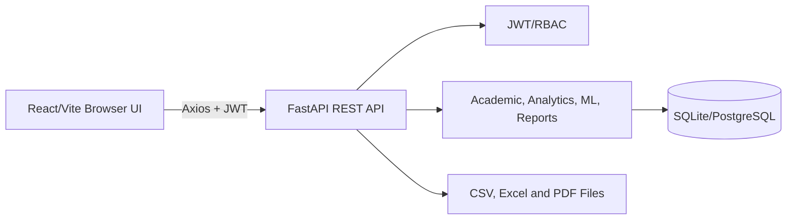
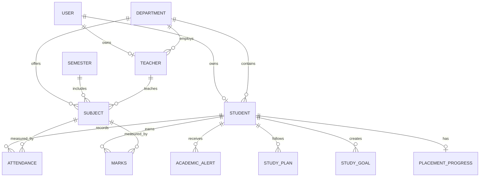

# EduTrack AI

EduTrack AI is a full-stack student academic performance and early-warning system for colleges. It includes role-based dashboards, attendance and marks management, configurable grading, academic analytics, interventions, a rule-based study planner, placement readiness, reports, CSV/Excel import, and a demonstration ML module.

> **Data notice:** all bundled users and academic records are synthetic. Predictions and risk indicators are decision-support estimates, not automated decisions.

## Technology Stack

- React 18, Vite, Tailwind CSS, React Router, Axios, Recharts
- FastAPI, SQLAlchemy, Pydantic, JWT, bcrypt
- SQLite for local development and PostgreSQL for Docker/production
- Pandas, NumPy, scikit-learn, ReportLab, OpenPyXL
- Docker Compose

## Demo Credentials

| Role | Email | Password |
|---|---|---|
| Admin | `admin@edutrack.ai` | `Admin@123` |
| Teacher | `ramesh.kumar@edutrack.ai` | `Teacher@123` |
| Student | First run seeding; use the email from `data/students.csv` | `Student@123` |

## Quick Start

### Local development

```powershell
python -m pip install -r backend/requirements.txt
python scripts/seed.py
python scripts/train_ml.py
python -m uvicorn app.main:app --app-dir backend --host 127.0.0.1 --port 8000 --reload
```

In a second terminal:

```powershell
cd frontend
npm install
npm run dev
```

Open `http://localhost:5173`. API documentation is available at `http://localhost:8000/api/docs`.

### Docker Compose

```powershell
docker compose up --build
```

Open `http://localhost:3000`.

### Single-container deployment platforms

The root `Dockerfile` builds the React frontend and runs it with the FastAPI backend behind Nginx in one container. For platforms such as Render that build from the repository root, select the Docker runtime, use the repository root as the build context, and set the service's port to `10000` (or let the platform provide `PORT`).

Configure these production environment variables in the hosting dashboard:

- `SECRET_KEY`: a long, unique random value
- `DATABASE_URL`: a managed PostgreSQL connection URL; do not rely on the container's local SQLite file for persistent production data
- `CORS_ORIGINS`: JSON array of allowed frontend origins if the API is accessed cross-origin

The service serves the frontend at `/`, API endpoints at `/api`, and API documentation at `/api/docs`.

## Database and Migrations

Local SQLite is configured by default:

```text
DATABASE_URL=sqlite:///./edutrack.db
```

PostgreSQL is provided by Docker Compose. Generate and apply migrations with:

```powershell
python -m alembic revision --autogenerate -m "initial schema"
python -m alembic upgrade head
```

The tables are also created on application startup for a first-run local setup.

## Validation

```powershell
python -m pytest backend/tests/test_edutrack.py -q
cd frontend
npm run build
```

Current automated backend suite: 10 tests passing.

## Main Modules

- Admin, teacher and student dashboards
- Student, teacher, department, subject and semester management
- Daily attendance and subject attendance
- Internal/external marks and configurable CGPA/grading rules
- Academic overview, subject, department and risk analytics
- Academic alerts and teacher intervention tracking
- Rule-based weekly study plans
- Student goals and achievements
- Placement readiness and skills
- Individual, department and college report downloads
- CSV/Excel preview and confirmed imports
- Audit logs and notifications
- JWT authentication with role-based endpoint protection

## System Architecture



## ER Overview



## DFD Level 1

```text
[Admin/Teacher/Student] -> [Authentication] -> [Role-Authorized API]
[Authorized User] -> [Student/Attendance/Marks/Goals] -> [FastAPI Services]
[FastAPI Services] -> [SQLAlchemy ORM] -> [Database]
[FastAPI Services] -> [Analytics/ML Engine] -> [Dashboard Estimates]
[Authorized User] -> [CSV/Excel Upload] -> [Preview/Validation] -> [Database]
[Authorized User] -> [Report Request] -> [PDF/Excel Generator] -> [Download]
```

## Known Limitations

- ML training uses synthetic data and is for demonstration only.
- The rule-based fallback remains available when no trained model exists.
- No paid external AI or placement-provider service is required.
- PostgreSQL should be used for deployment rather than SQLite.
- Production secrets must be replaced by environment variables.
- Chart bundle splitting and formal rate limiting can be added before high-volume production use.

## GitHub Upload

```powershell
git status
git add .
git commit -m "Complete EduTrack AI full-stack project"
git branch -M main
git remote add origin https://github.com/<username>/<repository>.git
git push -u origin main
```
